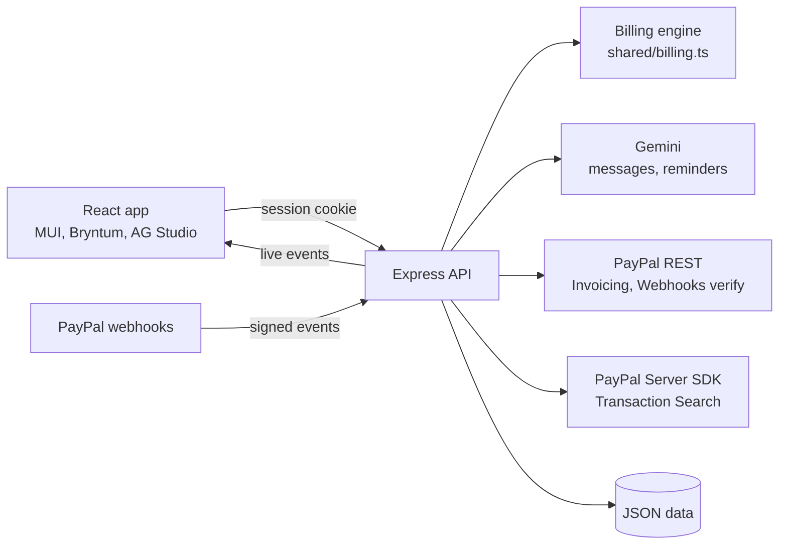

# Tanpura

**An AI billing assistant for anyone who bills by the session.** Tanpura turns your calendar into correct PayPal invoices for every client, in each client's own currency, approved in one go. It also reads the messages people send ("Aarav is sick, please skip Saturday") and proposes the changes and their effect on the bill.

> A tanpura's steady drone keeps musicians in tune. Tanpura keeps your billing in tune.

- **Live demo:** https://tanpura.onrender.com (Render free tier: the first load can take about a minute while it wakes up)
- **Demo login:** shown on the sign-in page (`teacher@tanpura.app`, demo mode). Every sign-in gets its own private copy of the demo data, so visitors never see each other's changes.
- **Video (under 3 minutes):** https://youtu.be/8w9nzlQvqHQ

## The problem

Independent tutors, music and dance teachers, coaches and trainers bill many families every month. The bill depends on what actually happened: classes held, cancelled with notice, cancelled late, missed, rescheduled, made up. Teachers count it by hand, then chase people they have a personal relationship with.

- 29% of freelance invoices are paid late, and 85% of freelancers have been paid late ([Bonsai](https://www.hellobonsai.com/blog/late-freelance-payment), [Plutio](https://www.plutio.com/freelancer-magazine/late-invoice-payments)).
- Most late payments resolve at the first reminder: the client simply forgot ([Plutio](https://www.plutio.com/freelancer-magazine/late-invoice-payments)).
- For music schools, inconsistent billing and awkward chasing let unpaid months pile up until families disengage ([Noto](https://www.withnoto.com/blog/how-to-reduce-late-payments-at-a-music-school)).

PayPal can already send invoice reminders, but if the bill is wrong, reminders don't help. **Tanpura makes the bill right first.**

The demo follows Lakshmi, a Carnatic music teacher in Coimbatore, India, with 20 students in the US, UK and Australia. Tanpura works the same way for any tutor, coach, therapist or trainer who bills by the session: at first sign-in it asks once what kind of work you bill for (**Teaching**: students and families, or **Client sessions**: clients and sessions), and speaks that language everywhere, from the screens to the PayPal invoices and the AI's replies. The billing is the same either way.

## What it does

| | |
|---|---|
| **Bills from the calendar** | Every class is counted from what happened. Each invoice line lists its class dates, so families can see exactly what they pay for. |
| **Bills in advance, corrects later** | Like school fees: bill next month's classes before it starts. Classes cancelled with notice and not made up become credits on the next bill; extra classes and late changes are charged on the next bill. Nothing is charged twice or missed. (Billing after the month is a setting.) |
| **One approval, every family** | Review all bills, see what needs a decision (missed classes, credits, late payers), then tick the ones to send as PayPal invoices, each in the family's currency (USD, GBP, CAD, AUD, NZD, SGD or EUR). |
| **AI assistant for messages** | Paste a message from a family, or describe your own day ("I'm unwell tomorrow"). Gemini works out which classes it means, Tanpura proposes the cancellations and makeups, shows the effect on the next bill, and drafts a reply. Nothing changes until the teacher approves. |
| **Friendly reminders** | For an overdue invoice, Gemini drafts a warm reminder from the family's payment history; the teacher edits it and PayPal sends it with the invoice link. |
| **Live payments** | When a family pays, a PayPal webhook updates the invoice and the app shows "Priya paid US$90" straight away. |
| **What you actually keep** | Payments of your Tanpura invoices received through PayPal this month, PayPal's fees and the net amount, matched to each family's invoice, with an approximate total in your own currency (e.g. ≈ ₹) at each payment date's reference rate. |
| **Students and enrolment** | Add or edit a student (who pays, country and time zone, rate, weekly times shown in both time zones, with overlaps refused). End an enrolment when someone stops: later classes leave the calendar, classes already paid for become a refund owed, and "Mark refunded" records it once you have refunded on PayPal. |
| **Exports** | Invoices and payments as CSV for accounts or tax time. |
| **Dashboard** | Billed vs collected by month, a "payment rhythm" heatmap (how fast each family pays each month), invoice states and class outcomes, plus an AI assistant (Gemini) that answers questions by building charts. |

Works on phones and desktops, in light and dark mode, with voice input for the assistant (browser speech recognition). Flexible rules: attendance can be automatic (a class counts as held once it ends) or manual; each student has their own rate and any class can have its own price; no-shows and late cancellations are charged or free by setting, and any single class can be waived.

## How it uses PayPal

All in the PayPal sandbox, server-side only:

- **Invoicing v2:** create and send invoices (with a unique invoice number per student and month, so a retry can never create a second invoice; an existing number is reused only for the same open bill), credits as an invoice discount, invoice reminders, cancel, record an outside payment, search and fetch invoice status, and open any invoice on PayPal. When PayPal refuses an invoice, its own reason is shown.
- **Webhooks:** `INVOICING.INVOICE.PAID` and `CANCELLED`, with every event's signature verified through PayPal before anything changes.
- **Transaction Search** through PayPal's TypeScript Server SDK (`@paypal/paypal-server-sdk`, generated by APIMatic): payments received, fees and net, matched to invoices.
- **Country-aware features:** PayPal doesn't offer partial payments on invoices in India, Brazil or Israel, so Tanpura turns them on only where the teacher's PayPal country allows ([PayPal docs](https://developer.paypal.com/docs/platforms/invoicing/integrate/)). An Indian PayPal account can only invoice customers outside India, which is exactly the teacher-in-India, families-abroad case Tanpura is built for.

## How it uses AI

- **Gemini reads messages** with a JSON response schema. It may only refer to classes and students Tanpura gave it, and every answer is validated again on the server.
- **The AI never decides money.** Billing is plain, tested code. Whether a cancellation is late is computed from the teacher's notice rule, not by the AI. Proposed changes are simulated with the app's own rules to show the exact bill impact, then applied only after approval, all together or not at all.
- **Family time zones:** a parent's "Saturday" means their Saturday, which can be Sunday in India.
- **Reminders** are written from facts (amount, month, how late, past payments), kind and short, and always edited by the teacher before PayPal sends them.
- **Guarded:** a family's message is treated as text to read, never as instructions; the dashboard assistant only works on the dashboard; and hourly and daily limits of AI calls per visitor keep the public demo from using up the key.
- **Busy models:** if the chosen Gemini model is slow or overloaded, the request is retried and then moved to a stable Flash model; **without a key** (or if Gemini still fails), Tanpura falls back to built-in rules, so the app keeps working.

## Built with

| Part | Tool |
|---|---|
| Frontend | React 19, Vite, MUI 9 (+ MUI X date pickers), React Query, React Router |
| Calendar | **Bryntum Calendar** (class calendar in the teacher's time zone; click a class to mark it, waive it or book a makeup) |
| Dashboard | **AG Studio** (report over Tanpura's data, with a custom "payment rhythm" heatmap widget) |
| Backend | Node.js, Express 5, zod, helmet |
| Payments | **PayPal** Invoicing v2, Webhooks, Transaction Search via PayPal's Server SDK (**APIMatic**) |
| AI | **Google Gemini** API |
| Hosting | **Render** (`render.yaml` blueprint) |

## Architecture



- `shared/` holds the billing engine, request schemas and API types, used by both sides.
- **The billing engine** treats every scheduled class as an entitlement and keeps a ledger of what each invoice charged or credited for it. A bill is "what each class should be charged now, minus what was already charged", so a waiver, a makeup or a cancelled invoice is corrected on the next bill automatically.
- Every API route except health, sign-in and the PayPal webhook needs the teacher's session (a signed, httpOnly, SameSite=Strict cookie). All input is validated, mutations must be JSON, and the server rebuilds every bill before sending: a bill that changed since the teacher reviewed it is held back.

## Run it locally

Requires Node.js 22.12 or later.

```bash
npm install
cp backend/.env.example backend/.env   # optional: add keys, or leave blank for mock mode
npm run dev                            # API on :3001, app on http://localhost:5173
```

Sign in with the demo login shown on the sign-in page. Without keys, PayPal and Gemini run in **mock mode**: invoices are recorded but not sent, and messages are read with the built-in rules. Demo data is created around today's date on first start; `npm run seed` rebuilds it.

| Variable | What for |
|---|---|
| `PAYPAL_CLIENT_ID`, `PAYPAL_SECRET` | PayPal sandbox REST app (enable **Transaction search** on the app for the Payments tab) |
| `PAYPAL_WEBHOOK_ID` | Webhook on the same app, URL `https://<host>/api/paypal/webhook`, events: invoice paid / cancelled |
| `DEMO_BUYER_EMAIL` | Your sandbox personal (buyer) account, used as one family's email, so you can pay a demo invoice |
| `GEMINI_API_KEY`, `GEMINI_MODEL` | Gemini (the model defaults to a current Flash model the key can use) |
| `AG_STUDIO_LICENSE` | AG Studio licence key (without one, the dashboard shows a trial watermark) |
| `APP_EMAIL`, `APP_PASSWORD`, `SESSION_SECRET` | Teacher sign-in (required in production) |

Other scripts: `npm test` (engine, assistant and API tests, including a check that every route rejects requests without a session), `npm run typecheck`, `npm run build`, `npm start` (serves the built app).

## Deploy to Render

Create a Blueprint from this repo (`render.yaml`), then fill in the secret variables. The free plan's disk is temporary, so the demo data is rebuilt around the current date on each start.

## Try it

1. Open the demo and choose **Use demo** on the sign-in page, then pick **Teaching** (the demo story) when asked what kind of work you bill for.
2. **Billing → To send:** open a bill to see each line with its class dates and the flags that need a decision; waive a missed class and watch the total change; tick bills and **Send** them as PayPal invoices.
3. **Assistant** (top right): try "Hi Lakshmi, Aarav has a fever and will miss Saturday. Could we do a makeup on Monday instead? Priya", review the proposal and its bill impact, then apply it.
4. **Sent invoices:** send a friendly reminder to an overdue family, or open an invoice in PayPal.
5. Pay the invoice sent to the sandbox buyer account (the family using `DEMO_BUYER_EMAIL`) and watch the app announce the payment; **Payments received** shows the fee and what you keep.
6. **Students:** add a student, or end one's enrolment and see the refund on their final bill.
7. **Calendar** and **Dashboard:** see classes in Bryntum and the payment rhythm in AG Studio.
8. **Settings → Reset** rebuilds your copy of the demo data at any time.

## Credits

- The PayPal REST client started from [PayPal's PayPal + AG Grid boilerplate](https://github.com/paypaldev/hackathon-paypal-ag-grid-boilerplate).
- Students, families and classes in the demo are made up.

## Licence

[MIT](LICENSE)
